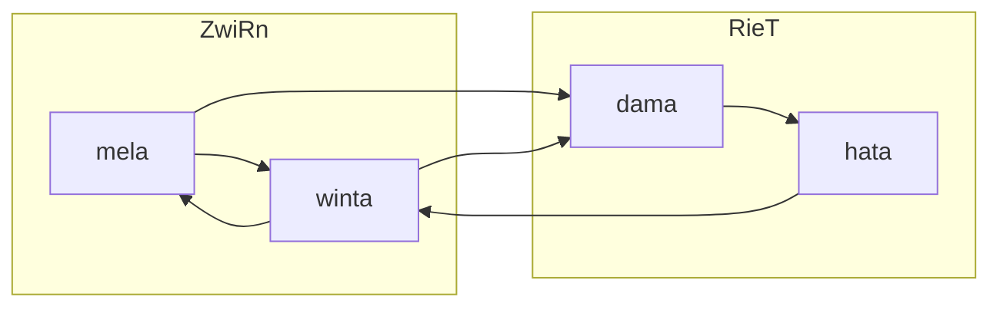

# Webstuhl: an architecture across representations

**Loom is the English translation. Webstuhl is the deliberately retained name.**

Webstuhl connects language-level specification with implemented processing: structure, function and interfaces are expressed separately, unfolded into architecture and examined through concrete operations.

## Why the German name is part of the design

German weaving terms were selected to keep a coherent family of analogies available to the interpreting agent. English words such as *thread* already carry strong computing meanings. Using the same vocabulary for a new architectural role can activate competing associations.

Keeping **Webstuhl** and German names for its elements is a pragmatic choice of semantic space. It selects the intended analogy and reduces overlap with established IT vocabulary. The effect is part of the motivation for semantic addressing: naming influences which prior landscape an agent is invited to use.

This is the developer's design rationale. It is not presented as a measured claim that German terminology universally outperforms English.

## From a language-level goal to modules

The selected source, `goal.software.yml`, describes two crates and four modules. Each module carries a structural expression and a functional expression. Directed interfaces connect modules through named processes.

This reduced view preserves the stated connectivity and leaves the private expression definitions out. The synthesis workflow is: interpret the structural and functional expressions, produce modules and interfaces, then check the result against its source.

## What remains stable when the backend changes

The architectural contract separates the work from its representation: accept source content, compose it in order, retain its context and compare it within a defined space. The representation, comparison operation and numerical scale belong to the selected backend.

| Development stage | Existing functionality or evidence | Representation |
|---|---|---|
| Earlier vector implementation | Text encoding, composition, sequence and container operations; memory/recall building blocks | VSA/HDC, including FHRR paths |
| Calibrated symbolic comparison | Group comparisons, scope separation and paired trajectories; 30/30 calibration cases | Deterministic 512-bit symbolic projection |
| Geotopie integration | Original-byte dictionary search, source occurrences, offsets and native distance; executed tensor/persistence reference views | Native tensor representation and typed content structures |

The architectural roles persist across these iterations; their mathematical realization changes. An FHRR cosine value, a 512-bit Hamming count and a native tensor distance are different measurements. Backend independence means preserving the required behavior through an adapter and its tests, rather than retaining the same score or threshold.

The recorded Geotopie integration implements useful parts of that contract. Its migration documents still identify continuous recursive inline checking and feedback as an outstanding end-to-end path. The available evidence therefore shows working implementations and an ongoing backend migration, rather than complete parity of every function.

## A concrete example of measurement

Under the historical 512-bit identity projection, `Kraft` and `kraft` differ by **111 bits**. Under the NFC/lowercase projection, the recorded distance is **0 bits**. The measurement changes because the selected projection treats case differently.

The same apparatus processed **8,191 readings**, retained **128 address scopes** and constructed **3,199 trajectory pairs**. These are concrete processing results; their interpretation depends on the selected measurement.

See [measurements and worked examples](../research/webstuhl-geotopie.md) for the conditions, additional values and Geotopie demonstrations.

## From analysis to a later agent action

The [correction-transfer case](correction-transfer.md) connects stored source records, Webstuhl candidates and scoped context delivery to a later agent's changed action. It is an internally documented technical example with its evaluation limits stated. Language, analysis, memory and runtime responsibilities are separated in [the architecture overview](../concepts/language-memory-runtime.md).
