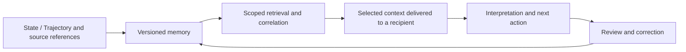

# Language, memory and runtime

MeSH'lAng can participate in an agent system without being identical to its storage, context-delivery or execution mechanisms.

| Component | Responsibility | Separate question |
|---|---|---|
| Language/profile | Express process relations or mathematical operations. | Did an interpreter preserve their meaning? |
| Geotopie | Preserve and resolve addressed source records, revisions and traces. | Was the required record retrieved completely and correctly? |
| Webstuhl | Analyse and correlate represented contributions. | Is a candidate relationship relevant to the current goal? |
| Hooks/context delivery | Deliver selected, scoped information to a recipient. | Did those bytes actually reach the intended model? |
| Constitution/work protocol | Bind goals, roles, review, correction and stop conditions. | Were the rules followed in the executed workflow? |
| Runtime | Materialise files, enforce access/resource limits and execute tools. | Did the permitted operation occur within the actual boundary? |

The arrows describe the intended feedback contract, not a claim that every deployment has completed the integration.

A tensor image is a registered context address in the demonstrated implementation. Its exact symbol order and cluster delimiter matter. Emitting an address, resolving it, delivering its payload, interpreting it and changing an action are distinct observations. A semantic address is not a filesystem permission.

The stability objective is that a relevant earlier correction can influence a later decision, including after a session change. This is context-mediated correction transfer; it does not claim training of model weights. A recurrence of an error can still happen. The question is whether the retained correction changes subsequent handling without repeated manual re-anchoring.

See [the correction-transfer case](../case-studies/correction-transfer.md). The [public fragment](../examples/public-fragment/README.md) can be tried without any of these infrastructure components; its result cannot therefore establish their added effect.
